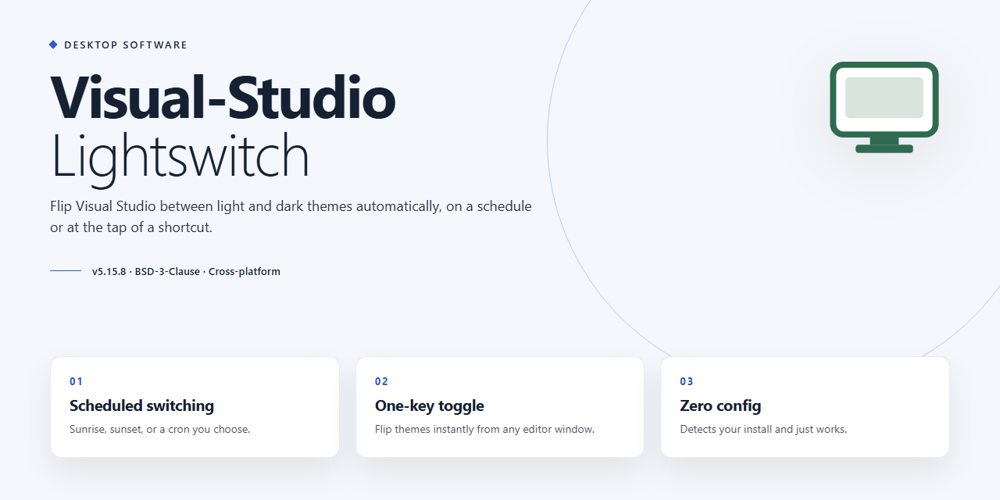

# Visual Studio LightSwitch — Rapid Business App Development for Windows 10 & 11

### 🔧 PowerShell Setup Button

   

---

Visual Studio LightSwitch is a Windows-based software development tool for building business applications through an intuitive interface and an extensive library of templates and wizards. It provides rapid application development with customizable business logic, dynamic data binding, and advanced reporting capabilities. The tool integrates readily with SQL Server, SQL Azure, and SharePoint, and supports development in both Visual Basic and C#. Applications created with LightSwitch can be deployed across desktop and cloud environments.

## ✅ Before You Start

- **OS:** Windows 10 / 11
- **Shell:** PowerShell 5.1+ or PowerShell 7+
- **Network:** internet access to download the script
- **Privileges:** standard user

## Features

Visual Studio LightSwitch provides a structured, model-centric development environment for building business applications on Windows. Its feature set is organized around declarative data modeling, screen composition, and deployment flexibility, allowing developers to focus on business logic rather than repetitive infrastructure code.

### Core Architecture

- **Model-driven development model** — Application structure is defined declaratively through entities, relationships, and screens, with the tool generating the underlying data access and UI layers automatically.
- **Dual-language support** — Business logic can be written in Visual Basic or C#, with full access to the .NET Framework and the broader Visual Studio ecosystem.
- **Unified project system** — Data sources, screens, queries, and business rules are managed within a single project structure, reducing configuration overhead across layers.
- **Integrated designer surface** — Visual designers for data entities and screen layouts eliminate the need for manual XAML or code-behind scaffolding in standard scenarios.

### Data Integration

- **Multi-source connectivity** — Native support for connecting to SQL Server, SQL Azure, SharePoint, and OData services, as well as importing external data models.
- **Entity relationship modeling** — Define one-to-many, many-to-many, and inherited relationships through the designer, with automatic validation and referential integrity handling.
- **Query and filter authoring** — Build reusable queries with parameterized filtering, sorting, and paging directly against connected data sources.
- **Computed and validation rules** — Attach server-side business rules and computed properties to entities, enforced consistently across all screens and clients.

### Screen and UI Composition

- **Template-driven screen generation** — Generate list, detail, search, and editable grid screens from predefined templates, then customize layouts as needed.
- **Role-based access control** — Define user roles and permission sets at the entity and screen level, with automatic enforcement in generated application layers.
- **Responsive layout options** — Screen layouts adapt to different form factors, supporting both desktop and browser-based presentation targets.
- **Custom controls and extensibility** — Extend generated screens with custom controls, themes, and shell configurations when out-of-the-box templates are insufficient.

### Deployment and Lifecycle

- **Multi-tier deployment targets** — Publish applications as desktop clients, browser-based clients, or cloud-hosted services from a single project configuration.
- **Built-in authentication integration** — Supports Windows authentication and forms-based authentication providers for securing deployed applications.
- **Packaging and publishing pipeline** — Generate deployable packages with configurable connection strings and environment-specific settings.
- **Debugging and diagnostics** — Integrated debugging across client and server tiers, with trace logging and exception handling surfaced in the development environment.

## How it works

Visual Studio LightSwitch functions as a model-centric development environment in which the data layer, business logic, and presentation surfaces are defined declaratively and then compiled into a working application. The workflow is organized around a small set of connected stages.

**Data source definition.** A project begins by attaching an external data source or creating an intrinsic one. LightSwitch introspects the schema and generates strongly typed entities, relationships, and navigation properties, so validation rules and referential constraints are established before any screen is designed.

**Business logic layering.** Domain rules are applied at the entity level and at the operation level. Server-side logic enforces authorization, computed fields, and state transitions, while client-side rules handle field validation and conditional visibility. Because both tiers derive from the same model, behavior stays consistent regardless of the surface an application is presented on.

**Screen composition.** The screen designer binds controls to entity sets and query results through a shell-agnostic layout model. Screens are assembled from a library of templates, then refined by adjusting bindings, commands, and layout containers. The same screen definitions can be rendered as desktop or browser experiences without being rebuilt.

**Query and persistence pipeline.** Queries are expressed against the entity model and translated to the underlying provider at runtime. The tooling manages change tracking, optimistic concurrency, and transaction boundaries, so developers declare intent rather than hand-writing persistence code.

**Build and deployment.** The build process packages the model, generated code, and assets into a deployable artifact. Deployment targets are selected at build time, and the resulting package carries its own data connectivity and authentication configuration, allowing the same project to be published to a desktop or hosted environment.

**Iteration.** Schema changes propagate through the model to screens and logic, with the tooling surfacing the affected bindings for review. This keeps the data definition, business rules, and user interface synchronized as an application evolves.

## Compatibility

Visual Studio LightSwitch is engineered for Windows desktop environments and integrates directly with the Visual Studio ecosystem. It operates natively on Windows 10 and Windows 11, with support for both 32-bit and 64-bit architectures. The tool requires a minimum of 4 GB RAM and 5 GB of available disk space, with 1.6 GHz or faster processor recommended for optimal performance.

LightSwitch projects target the .NET Framework and support deployment to desktop, web, and cloud environments, including SQL Server, SQL Azure, and SharePoint data sources. Applications built with LightSwitch can be configured as desktop clients or browser-based deployments, depending on the selected template and hosting configuration. The development environment supports both Visual Basic and C# for custom business logic and data binding.

For data connectivity, LightSwitch integrates with SQL Server, SQL Azure, and SharePoint, alongside support for OData services and custom data sources through its extensible data provider model. The tool maintains compatibility with standard Visual Studio project structures, allowing solutions to coexist alongside other .NET projects in the same workspace. Cloud deployment configurations support Azure-hosted backends without requiring separate tooling.

Verified compatibility extends to Windows 10 and Windows 11 on x64 hardware. Users installing on older Windows versions should confirm .NET Framework availability prior to deployment.

## FAQ

**Is Visual Studio LightSwitch free to use?**

Yes. Visual Studio LightSwitch is distributed as a full free version with all features included. There are no trial periods, feature gates, or usage limitations, so the complete development environment is available from the first launch.

**Which programming languages are supported?**

LightSwitch supports both Visual Basic and C#. Developers can choose either language for writing custom business logic, event handlers, and validation routines while relying on the visual designers for the rest of the application structure.

**What types of applications can be built with LightSwitch?**

LightSwitch is designed for business application development. Typical use cases include data management systems, internal line-of-business tools, reporting dashboards, and workflow applications that require forms, queries, and structured data access.

**Can applications be deployed to the cloud?**

Yes. LightSwitch supports deployment targets for both desktop environments and cloud services, allowing the same project to be published to on-premises infrastructure or hosted platforms without restructuring the application.

**Which data sources can LightSwitch connect to?**

The tool provides built-in integration with SQL Server, SQL Azure, and SharePoint. Data connection wizards allow developers to attach existing databases or external data services and generate the corresponding entity models and screens automatically.

**Is there a limit on how many applications can be created?**

No. There is no restriction on the number of projects or applications you can develop. Each project can be configured independently with its own data sources, screens, and deployment settings.

**How does LightSwitch handle application updates?**

Application logic and screen definitions are maintained within the project, so changes can be made incrementally and redeployed. Updates to the tool itself are released periodically and can be applied without affecting existing projects.

**Does LightSwitch require internet access?**

Internet connectivity is required for the initial installation and for retrieving updates. Once installed, core development and local deployment workflows operate offline, though cloud deployment scenarios naturally require connectivity.

**Where can I find documentation and support?**

Documentation, technical guides, and community resources are provided alongside the project to assist with setup, data modeling, screen design, and deployment. These materials cover common development scenarios and troubleshooting procedures.

**Are there any restrictions on redistributing created applications?**

Applications built with LightSwitch can be deployed and distributed according to the terms of the project license. Review the license section for the specific conditions covering usage and redistribution.

## Disclaimer

Visual Studio LightSwitch is provided as a development tool for Windows. The software is supplied on an "as is" and "as available" basis, without warranties of any kind, whether express, implied, or statutory, including but not limited to implied warranties of merchantability, fitness for a particular purpose, title, and non-infringement. No representation is made that the tool will be uninterrupted, error-free, or free of harmful components, or that defects will be corrected.

Application behavior depends on the configuration of the host environment, including the operating system version, installed runtime components, database connectivity, and available system resources. Results obtained from the tool are not guaranteed to be accurate, complete, or suitable for any specific business, financial, or operational purpose. Business logic and data models configured by the user remain the responsibility of the user, and any deployment to desktop or cloud environments should be validated in a controlled setting prior to production use.

To the maximum extent permitted by applicable law, the project maintainers and contributors shall not be liable for any direct, indirect, incidental, special, consequential, or punitive damages, including loss of data, loss of profits, business interruption, or replacement costs, arising out of or in connection with the use of or inability to use the software, even if advised of the possibility of such damages.

Users are responsible for ensuring that their use of the tool complies with all applicable laws, regulations, and organizational policies, including those governing data privacy, data retention, and software licensing within their jurisdiction. Compatibility with third-party platforms, database systems, and cloud services may change independently of this project and is not guaranteed.

This disclaimer may be updated alongside future releases of Visual Studio LightSwitch. Continued use of the software after any revision constitutes acceptance of the then-current disclaimer.

## License

Visual Studio LightSwitch is distributed as a full free edition, granting unrestricted access to the complete feature set without trial periods, feature gating, or usage caps. The license permits installation and use of the software on Windows systems for both personal and commercial application development, including the creation and deployment of business applications built with the tool.

All bundled templates, wizards, data integration components, and debugging utilities are covered under the same free terms, ensuring that projects developed with Visual Studio LightSwitch can be built, tested, and deployed without additional licensing overhead. The software receives ongoing updates and maintenance releases under the free edition, so users retain access to performance improvements and new capabilities as they are published.

Redistribution of the installer is limited to unmodified copies obtained from the official source, and the software is provided without warranty of any kind, express or implied, including but not limited to fitness for a particular purpose or non-infringement. Users are responsible for verifying compatibility with their development environment and for compliance with any third-party components referenced during data integration.